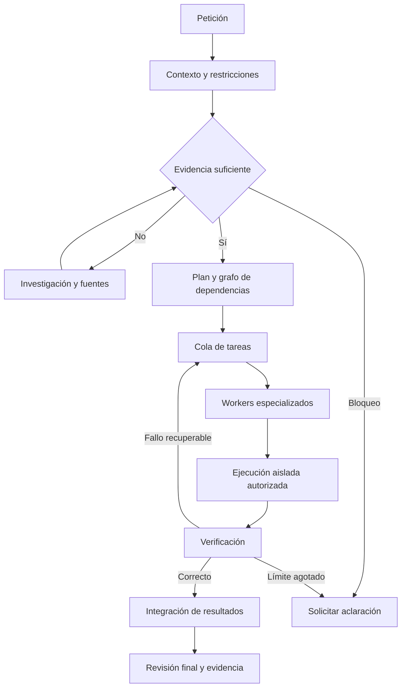

# Research-first autonomous agent runtime

**Estado:** arquitectura en desarrollo con un prototipo local ejecutable; no representa un runtime validado en producción.

## Por qué estoy investigando esto

No estoy en contra de la inteligencia artificial. Cuestiono una forma de utilizarla: cuando recibe una tarea con contexto insuficiente, a veces empieza a generar código sin comprender el problema, consultar documentación, revisar dependencias ni comprobar sus supuestos. El resultado puede parecer funcional y aun así introducir errores, deuda técnica o decisiones sin fundamento.

Estoy diseñando un agente autónomo que investigue antes de construir, descomponga el trabajo en subtareas y delegue su ejecución de forma controlada. La autonomía no significa ejecutar cualquier acción sin supervisión, sino tomar decisiones justificadas dentro de límites explícitos.

## Diseño propuesto



### Componentes

| Componente | Responsabilidad |
|---|---|
| Orquestador | Divide objetivos, construye el grafo de dependencias y conserva el presupuesto global. |
| Research worker | Consulta documentación permitida, contrasta fuentes y registra incertidumbres. |
| Cola | Gestiona tareas listas, concurrencia limitada, leases y recuperación de trabajos interrumpidos. |
| Workers especializados | Reciben contexto mínimo, contrato de entrada y criterio de aceptación. |
| Ejecutor | Ejecuta herramientas o subprocesos dentro de un sandbox con límites y permisos explícitos. |
| Verificador | Contrasta resultados con requisitos, ejecuta pruebas y bloquea resultados insuficientes. |
| Registro de eventos | Conserva transiciones, artefactos, fuentes, errores y métricas sin exponer secretos. |

## Ciclo de vida y concurrencia

Estados propuestos: pending, ready, running, verifying, succeeded, failed, cancelled, blocked.

Las tareas independientes pueden ejecutarse en paralelo; las dependientes solo avanzan cuando sus predecesoras han sido verificadas. Se debe rechazar un grafo cíclico antes de comenzar. La cola debe admitir reintentos acotados, backoff, cancelación y leases con expiración. Las tareas que producen efectos externos necesitan claves de idempotencia y confirmaciones según la política; un timeout no prueba que una acción externa no haya ocurrido. La investigación también tiene límite de tiempo y de iteraciones: si no resuelve una incertidumbre material, debe solicitar aclaración en lugar de inventar una respuesta.

Los subagentes son roles lógicos; un subproceso es un mecanismo del sistema operativo. No toda subtarea requiere un proceso separado. Cuando sí sea necesario ejecutar código, propongo un entorno aislado, con límites de CPU, memoria, tiempo y acceso al sistema de archivos y red. Un subproceso por sí solo no es una frontera de seguridad.

## Contrato mínimo de subtarea

```json
{
  "id": "validate-contract",
  "dependsOn": ["research-api"],
  "worker": "verification",
  "acceptanceCriteria": ["schema checks pass"],
  "maxAttempts": 2,
  "timeoutSeconds": 30,
  "status": "pending"
}
```

La salida debe incluir estado, artefactos, fuentes cuando correspondan, resultados de pruebas y errores estructurados. Los resultados de herramientas y documentos externos se tratan como datos no confiables, no como nuevas instrucciones de autoridad.

## Primer experimento reproducible

Construir un orquestador local con tres workers simulados (Research, Architect y Verification), una cola acotada, un DAG y un registro de eventos. Empezar con datos ficticios y sin proveedores externos; medir antes de incorporar modelos, MCP, sandboxes remotos o persistencia distribuida.

```gherkin
Feature: Ejecución de agentes basada en evidencia
  Scenario: Contexto insuficiente
    Given una tarea sin evidencia suficiente sobre una API
    When el orquestador evalúa sus requisitos
    Then no habilita la implementación
    And programa investigación o solicita aclaración

  Scenario: Dependencia pendiente
    Given una subtarea de implementación que depende de investigación
    When la investigación todavía no ha sido verificada
    Then la subtarea de implementación no se ejecuta

  Scenario: Presupuesto de reintentos agotado
    Given una tarea con dos intentos permitidos
    When ambos intentos fallan
    Then la tarea queda bloqueada o fallida
    And sus dependientes no se ejecutan
```

## Prototipo local implementado

El primer experimento está en [agent_runtime](../src/meridian_research/agent_runtime/). Requiere Python 3.11 o posterior; el runtime utiliza exclusivamente la biblioteca estándar. Pytest se usa únicamente para las pruebas.

- `contracts.py`: tareas, resultados, estados y contratos de workers.
- `runtime.py`: DAG validado antes de ejecutar, colas por niveles topológicos, concurrencia acotada, verificación y reintentos limitados.
- `demo.py`: investigación y planificación simuladas, con evidencia ficticia y salida JSON.
- [Pruebas](../tests/test_agent_runtime.py): dependencias, falta de evidencia, reintentos, timeout, verificador, concurrencia, cancelación y rechazo de grafos inválidos.

Desde la raíz del repositorio, con pytest instalado:

```bash
python -m pytest tests/test_agent_runtime.py
PYTHONPATH=src python -m meridian_research.agent_runtime.demo
```

En PowerShell, usar `$env:PYTHONPATH = "src"` antes de ejecutar el segundo comando sin el prefijo `PYTHONPATH=src`.

Validación local del prototipo: Python 3.13.5, pytest 9.0.2, 12 casos aprobados; la demostración produjo dos tareas exitosas. Se comprobó que los cinco archivos Python publicados coinciden con los archivos probados mediante sus SHA de blob Git. No se ha ejecutado la suite completa del repositorio ni confirmado CI.

### Límites del experimento

El DAG es definido por el llamador, no generado por un LLM. Los workers son funciones asíncronas confiables, no procesos aislados. La evidencia es sintética; el verificador de demostración no comprueba fuentes reales. El planificador procesa por niveles (una tarea lista puede esperar a otras del mismo nivel); no es un scheduler distribuido. No existe persistencia, backoff, leases, presupuesto temporal global, sandbox, MCP ni ejecución de acciones externas. Los timeouts y la cancelación son cooperativos; no detienen código bloqueante. Los reintentos solo están previstos para workers sin efectos externos. No se han aplicado mutation testing ni Hypothesis. Estas limitaciones deben resolverse antes de una implementación de producción.

## Cómo evaluar si mejora el resultado

Comparar el flujo research-first con una ejecución directa bajo las mismas tareas y presupuestos definidos. Medir corrección mediante pruebas de aceptación, cobertura de requisitos, decisiones sustentadas por fuentes, latencia, consumo de tokens y coste. Registrar también fallos, cancelaciones y casos en que investigar no aporta valor. No afirmar mejoras hasta disponer de resultados reproducibles.

## Relación con Meridian

Este documento amplía [Swarm Architectures](swarm-architectures.md), [Research Before Build](research-before-build.md) y [MCP y control de herramientas](mcp-context-and-tools.md). No divulga implementaciones privadas, credenciales ni datos de clientes.
